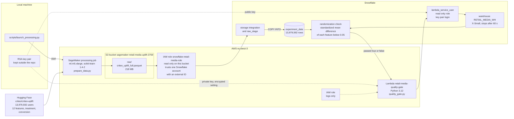
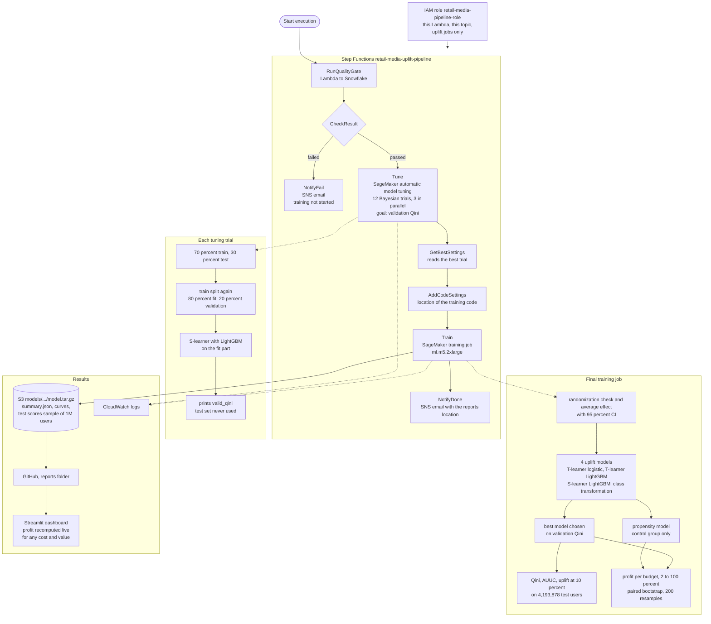
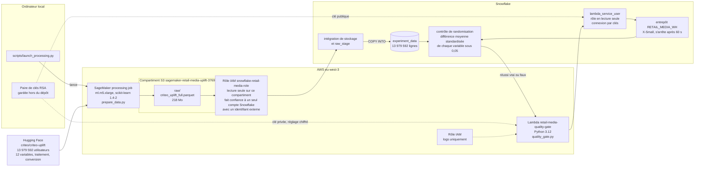
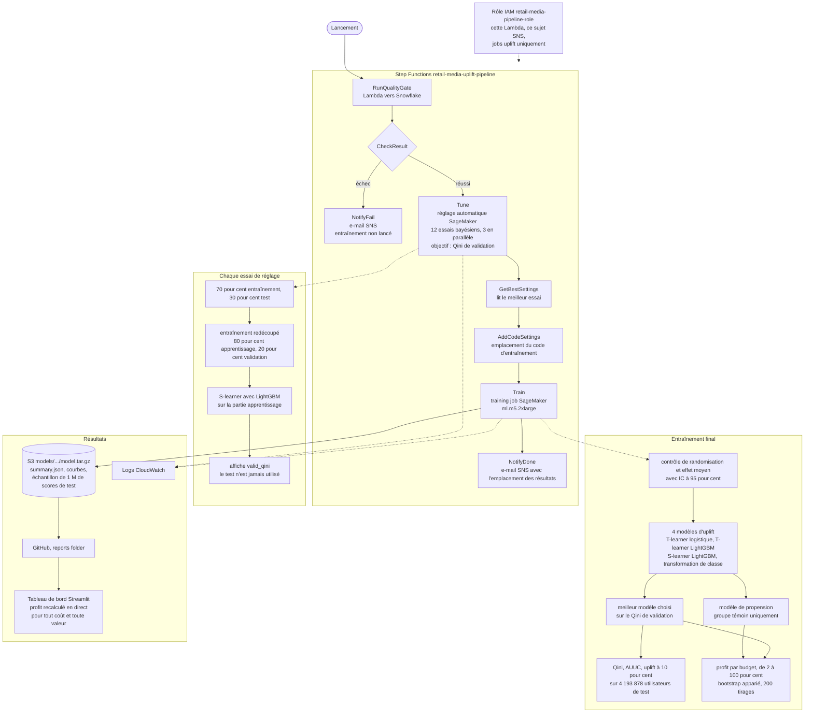

# retail-media-uplift

[](https://github.com/FatineKa/retail-media-uplift/actions/workflows/tests.yml)

Measure what advertising causes, not what it is correlated with, on Criteo's randomized ad experiment (13.9 million users).

**Dashboard:** https://retail-media-uplift-plus.streamlit.app/

## Architecture

### Data and quality gate



### Pipeline, tuning and training



## Data

- Criteo uplift dataset: a randomized experiment, users randomly kept out of advertising
- 13,979,592 users, 40,774 converters (0.29 %), 85 % treated, 15 % control
- 12 anonymous features
- Split: 70 % train, 30 % test (4,193,878 users); 20 % of train kept for validation

## Method

| Step | Approach |
|---|---|
| Quality gate | Standardized mean difference of each feature between groups, below 0.05 |
| Average effect | Difference in conversion rates, Welch 95 % CI |
| Uplift models | T-learner (logistic, LightGBM), S-learner (LightGBM), class transformation |
| Model choice | Best validation Qini; test set used once |
| Evaluation | Qini coefficient, AUUC, uplift at 10 % |
| Business layer | Profit per budget: 40 $ per extra conversion, minus 0.10 $ per ad shown |
| Policy comparison | Uplift targeting vs propensity targeting, same users, paired bootstrap 95 % CI |

## Results

- Advertising effect: +0.00115 conversion (95 % CI +0.00108 to +0.00122), +59.4 % relative lift

| Model | Qini coefficient | AUUC | Uplift at 10 % |
|---|---|---|---|
| S-learner, LightGBM | **+0.000389** | 3,685.2 | 0.00807 |
| T-learner, logistic | +0.000379 | 3,641.5 | 0.00805 |
| T-learner, LightGBM | +0.000314 | 3,371.6 | 0.00758 |
| Class transformation | −0.000153 | 1,412.3 | 0.00279 |

## Findings

- Three of the four models rank users better than random targeting
- Uplift targeting never earns significantly more than propensity targeting, at any budget
- Final run: propensity targeting earns significantly more from 6 % to 35 % of the audience (6 % budget: −8,389 $, 95 % CI −12,834 $ to −3,801 $)
- Fragile: a second tuning run with the same Qini found a significant gap only at 6 %
- Reason: the two lists target mostly the same people (82 % of the top 6 %, 81 % of the top 20 %, rank correlation 0.85)
- Ads lift conversion by about 0.45 points in the top 20 % of either list, four times the average: the users ads move most are mostly users already likely to buy
- Earlier 3M-row sample: propensity looked significantly better from 35 % to 84 %; with 4.6 times more converters, this gap disappears
- SageMaker tuning: validation Qini 0.000376 to 0.000393; small trees and slow learning win; a fast learning rate (0.2) makes the S-learner ignore the treatment column

## Limitations

- One dataset, one advertiser; 12 anonymous features
- Profit depends on fixed assumptions: 0.10 $ per ad shown, 40 $ per extra conversion (both editable in the dashboard)
- The dashboard uses a random sample of 1M test users; all results above use the 4.19M
- The Snowflake trial ended in September 2026: if the account is suspended, the pipeline stops at the quality gate, before training

## Cost

- Processing job: about 0.05 $
- Pipeline run (quality gate, 12 tuning trials, final training): about 0.70 $
- Snowflake: under 0.1 credit
- Nothing runs between pipeline runs

## Stack

- AWS: S3, SageMaker AI (processing, automatic model tuning, training), Lambda, Step Functions, SNS, IAM
- Snowflake: storage integration, SQL quality check, key pair login
- Python: pandas, scikit-learn, LightGBM, SciPy, Streamlit, pytest, GitHub Actions

## Structure

```
src/              data prep, uplift learners, Qini and AUUC, profit simulation, training
sagemaker/        code that runs on SageMaker machines
scripts/          start SageMaker jobs from a computer
snowflake/        storage integration, table, quality check SQL
lambda/           quality gate
step-functions/   the pipeline
aws/              IAM policies
notebooks/        exploration, uplift models, budget allocation (3M-row sample)
app/              dashboard
tests/            pytest
reports/          results of the pipeline run
```

## Run

Local sample:

```bash
pip install -r requirements.txt
python -m src.download --rows 3000000
python -m src.train
pytest tests/
streamlit run app/streamlit_app.py
```

Full dataset on SageMaker:

```bash
python scripts/launch_processing.py
python scripts/launch_tuning.py
python scripts/launch_training.py
```

---

# retail-media-uplift

[](https://github.com/FatineKa/retail-media-uplift/actions/workflows/tests.yml)

Mesurer ce que la publicité provoque, et non ce à quoi elle est corrélée, sur l'expérience publicitaire randomisée de Criteo (13,9 millions d'utilisateurs).

**Tableau de bord :** https://retail-media-uplift-plus.streamlit.app/

## Architecture

### Données et contrôle qualité



### Pipeline, réglage et entraînement



## Données

- Jeu de données uplift de Criteo : une expérience randomisée, des utilisateurs tenus à l'écart de la publicité au hasard
- 13 979 592 utilisateurs, 40 774 acheteurs (0,29 %), 85 % traités, 15 % témoins
- 12 variables anonymes
- Découpage : 70 % entraînement, 30 % test (4 193 878 utilisateurs) ; 20 % de l'entraînement gardés pour la validation

## Méthode

| Étape | Approche |
|---|---|
| Contrôle qualité | Différence moyenne standardisée de chaque variable entre les groupes, sous 0,05 |
| Effet moyen | Différence des taux de conversion, IC à 95 % de Welch |
| Modèles d'uplift | T-learner (logistique, LightGBM), S-learner (LightGBM), transformation de classe |
| Choix du modèle | Meilleur Qini de validation ; jeu de test utilisé une seule fois |
| Évaluation | Coefficient de Qini, AUUC, uplift à 10 % |
| Couche métier | Profit par budget : 40 $ par conversion supplémentaire, moins 0,10 $ par publicité affichée |
| Comparaison des stratégies | Ciblage par uplift contre ciblage par propension, mêmes utilisateurs, IC à 95 % par bootstrap apparié |

## Résultats

- Effet de la publicité : +0,00115 de conversion (IC à 95 % de +0,00108 à +0,00122), +59,4 % en relatif

| Modèle | Coefficient de Qini | AUUC | Uplift à 10 % |
|---|---|---|---|
| S-learner, LightGBM | **+0,000389** | 3 685,2 | 0,00807 |
| T-learner, logistique | +0,000379 | 3 641,5 | 0,00805 |
| T-learner, LightGBM | +0,000314 | 3 371,6 | 0,00758 |
| Transformation de classe | −0,000153 | 1 412,3 | 0,00279 |

## Constats

- Trois des quatre modèles classent les utilisateurs mieux qu'un ciblage au hasard
- Le ciblage par uplift ne rapporte jamais significativement plus que le ciblage par propension, quel que soit le budget
- Exécution finale : le ciblage par propension rapporte significativement plus de 6 % à 35 % de l'audience (budget de 6 % : −8 389 $, IC à 95 % de −12 834 $ à −3 801 $)
- Fragile : une deuxième exécution du réglage, avec le même Qini, ne trouve un écart significatif qu'à 6 %
- Raison : les deux listes ciblent surtout les mêmes personnes (82 % du top 6 %, 81 % du top 20 %, corrélation de rang 0,85)
- La publicité augmente la conversion d'environ 0,45 point dans le top 20 % des deux listes, quatre fois la moyenne : les utilisateurs que la publicité fait le plus changer sont surtout ceux qui allaient déjà probablement acheter
- Ancien échantillon de 3 M de lignes : la propension semblait significativement meilleure de 35 % à 84 % ; avec 4,6 fois plus d'acheteurs, cet écart disparaît
- Réglage SageMaker : Qini de validation de 0,000376 à 0,000393 ; les petits arbres et l'apprentissage lent gagnent ; un taux d'apprentissage élevé (0,2) fait ignorer la colonne de traitement au S-learner

## Limites

- Un seul jeu de données, un seul annonceur ; 12 variables anonymes
- Le profit dépend d'hypothèses fixes : 0,10 $ par publicité affichée, 40 $ par conversion supplémentaire (modifiables dans le tableau de bord)
- Le tableau de bord utilise un échantillon aléatoire de 1 M d'utilisateurs de test ; tous les résultats ci-dessus utilisent les 4,19 M
- L'essai Snowflake s'est terminé en septembre 2026 : si le compte est suspendu, le pipeline s'arrête au contrôle qualité, avant l'entraînement

## Coût

- Processing job : environ 0,05 $
- Exécution du pipeline (contrôle qualité, 12 essais de réglage, entraînement final) : environ 0,70 $
- Snowflake : moins de 0,1 crédit
- Rien ne tourne entre deux exécutions

## Outils

- AWS : S3, SageMaker AI (processing, réglage automatique, entraînement), Lambda, Step Functions, SNS, IAM
- Snowflake : intégration de stockage, contrôle qualité en SQL, connexion par clés
- Python : pandas, scikit-learn, LightGBM, SciPy, Streamlit, pytest, GitHub Actions

## Structure

```
src/              préparation des données, modèles d'uplift, Qini et AUUC, simulation de profit, entraînement
sagemaker/        code exécuté sur les machines SageMaker
scripts/          lancement des jobs SageMaker depuis un ordinateur
snowflake/        intégration de stockage, table, contrôle qualité en SQL
lambda/           contrôle qualité
step-functions/   le pipeline
aws/              politiques IAM
notebooks/        exploration, modèles d'uplift, allocation du budget (échantillon de 3 M de lignes)
app/              tableau de bord
tests/            pytest
reports/          résultats de l'exécution du pipeline
```

## Lancer

Échantillon local :

```bash
pip install -r requirements.txt
python -m src.download --rows 3000000
python -m src.train
pytest tests/
streamlit run app/streamlit_app.py
```

Jeu complet sur SageMaker :

```bash
python scripts/launch_processing.py
python scripts/launch_tuning.py
python scripts/launch_training.py
```
